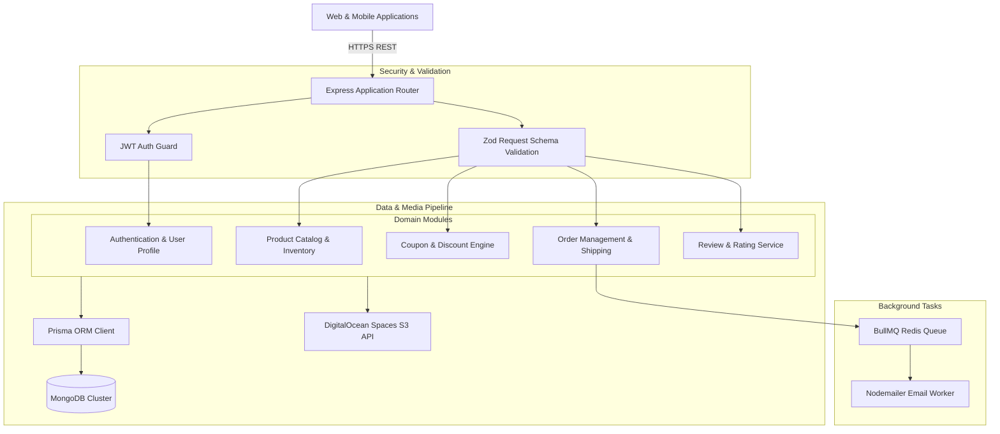

# FreemanZ Fly Backend - Aviation Commerce & Training Platform API

<p align="center">
  
</p>

<p align="center">
  <a href="https://nodejs.org"></a>
  <a href="https://expressjs.com"></a>
  <a href="https://www.typescriptlang.org"></a>
  <a href="https://www.prisma.io"></a>
  <a href="https://www.mongodb.com"></a>
  <a href="https://bullmq.io"></a>
  <a href="LICENSE"></a>
</p>

---

## 📖 Overview

**freemanzFly_backend** is FreemanZ Fly Backend (`freemanzFly_backend`) is a mission-critical e-commerce and pilot training platform API built with Node.js, Express.js, TypeScript, and Prisma ORM with MongoDB. The service manages flight gear inventories, coupon promotions, secure order fulfillment, customer reviews, DigitalOcean Spaces asset storage, and automated worker notification queues.

---

## ⚡ Key Features

- ✈️ **Pilot & Flight Gear E-Commerce:** Product catalog management with SKU tracking, categories, discounts, and inventory controls.
- 🎟️ **Promotional Coupon System:** Flexible coupon validation engine supporting percentage discounts, fixed reductions, and expiration controls.
- 📦 **Order Lifecycle & Shipping:** Automated checkout workflows, multi-address shipping book, status updates, and tracking.
- ⭐ **Customer Reviews & Feedback:** Verified purchaser reviews, star ratings, and moderation queues.
- 📬 **Asynchronous Email & Worker Queues:** Background workers powered by BullMQ and Redis for transaction confirmations and flight alerts.
- ☁️ **DigitalOcean Spaces CDN:** AWS S3-compatible media storage with automated ffmpeg/ffprobe asset processing.

---

## 🏗️ System Architecture



---

## 📂 Directory Structure

```text
.
├── src/
│   ├── app/
│   ├── components/
│   └── ...
├── assets/
│   └── banner.svg
├── .env.example
├── .gitignore
├── package.json
├── README.md
└── LICENSE
```

---

## 🛠️ Tech Stack & Dependencies

| Layer / Library | Version | Description |
|---|---|---|
| **Express.js** | `v4.21` | Core HTTP application framework |
| **TypeScript** | `v5.x` | Type-safe runtime architecture |
| **Prisma ORM** | `v6.x` | MongoDB schema definition and client queries |
| **BullMQ** | `v5.x` | High-performance background job processing with Redis |
| **AWS SDK (S3 Client)** | `v3.x` | Object storage handling for DigitalOcean Spaces |
| **Fluent FFmpeg** | `v2.1` | Media asset validation and transcoding |
| **Nodemailer** | `v6.x` | Automated transactional email dispatch |

---

## ⚙️ Environment Variables

Create a `.env` file in the project root based on the provided sample:

```bash
cp .env.example .env
```

Configurable variables:

```env
PORT=5000
NODE_ENV=development
DATABASE_URL=mongodb+srv://<username>:<password>@cluster.mongodb.net/freemanzfly?retryWrites=true&w=majority

JWT_SECRET=super_secret_jwt_key_here
JWT_EXPIRES_IN=7d
REFRESH_TOKEN_SECRET=super_secret_refresh_key_here
REFRESH_TOKEN_EXPIRES_IN=30d

# Redis / BullMQ
REDIS_HOST=127.0.0.1
REDIS_PORT=6379

# DigitalOcean Spaces / S3
DO_SPACES_ENDPOINT=https://nyc3.digitaloceanspaces.com
DO_SPACES_KEY=your_do_spaces_key
DO_SPACES_SECRET=your_do_spaces_secret
DO_SPACES_BUCKET=freemanzfly-storage

# SMTP
EMAIL_HOST=smtp.gmail.com
EMAIL_PORT=587
EMAIL_USER=notifications@freemanzfly.com
EMAIL_PASS=your_email_password
```

---

## 🚀 Getting Started

### Prerequisites

- Node.js (v20.x or higher recommended)
- Package Manager (`npm`, `yarn`, or `pnpm`)

### Installation

```bash
# Clone repository
git clone https://github.com/shahjalal-labs/freemanzFly_backend.git
cd freemanzFly_backend

# Install dependencies
npm install
```

### Running Locally

```bash
# Start development server
npm run dev
# or for backend services
npm run start:dev
```

### Building for Production

```bash
# Create production build
npm run build

# Start production server
npm start
```

---

## 📄 License

This project is licensed under the [ISC License](LICENSE).
